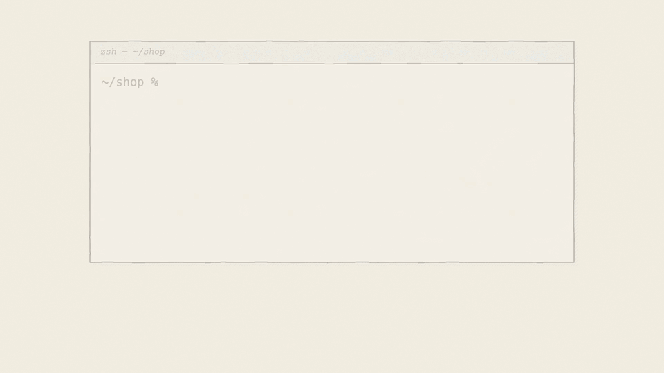
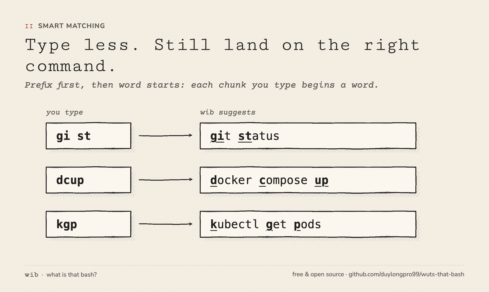
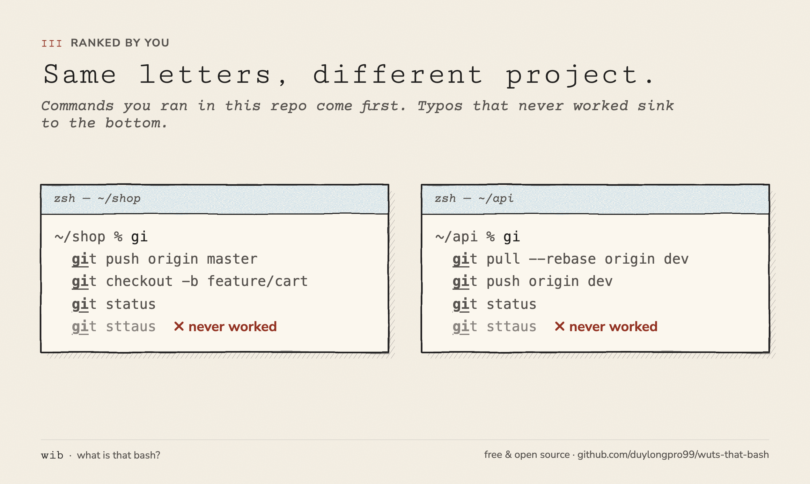
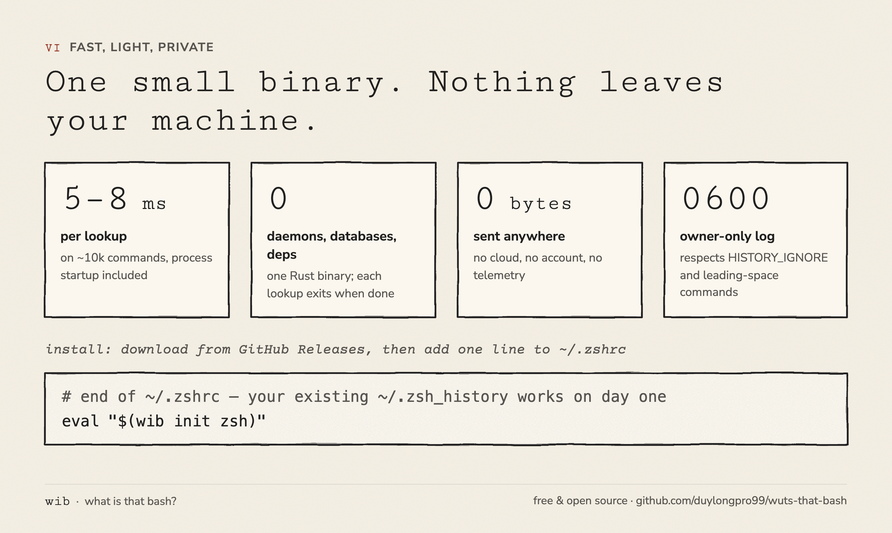
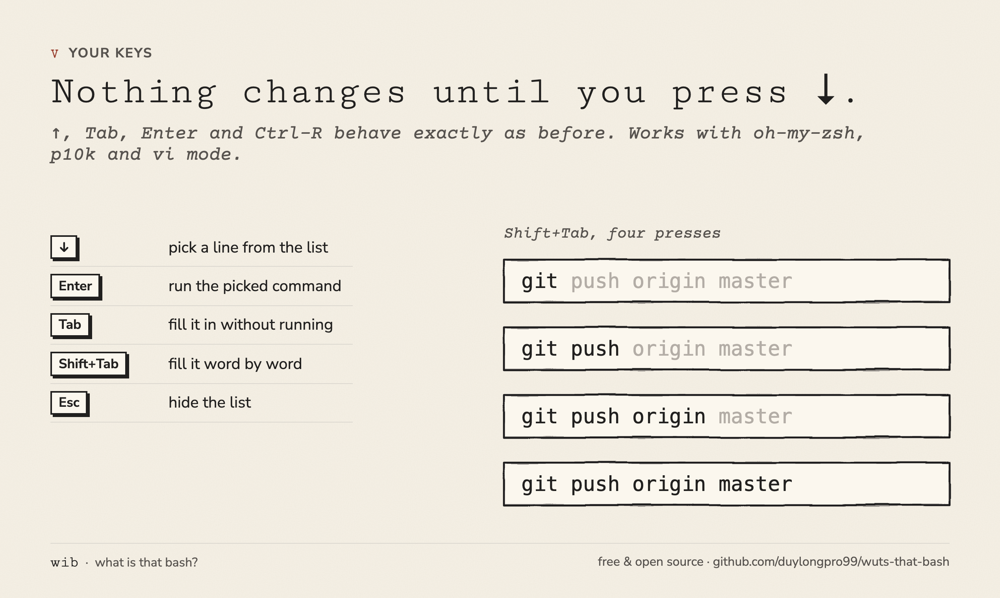
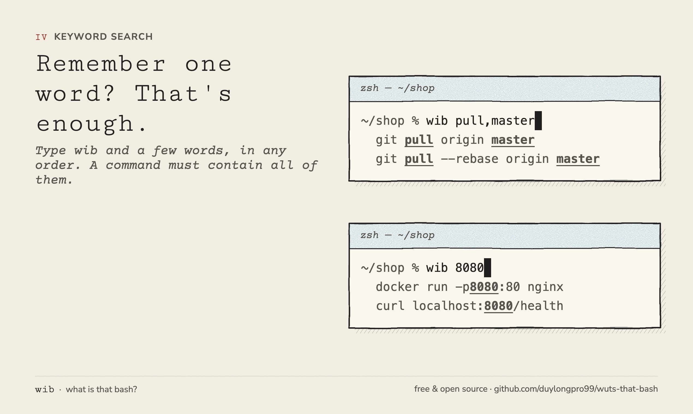

<div align="center">


# wib — what is that bash?

**Your shell history, surfaced the moment you start typing.**

Stop digging through Ctrl-R. Stop retyping that 80-character `docker run`.
Type two letters and the command you ran last Tuesday is already under your cursor.


</div>

<p align="center">
  <a href="marketing/product-hunt/wib-demo.mp4"></a>
  <br><sub>Click for the full-quality video.</sub>
</p>

---

## The 30-second pitch

You already know the command. You ran it yesterday. You just can't remember whether it was
`--force-with-lease` or `-f`, which port you mapped, or the exact path to that config file.

Today you either press Ctrl-R and play guess-the-substring, or you scroll up through hundreds of
lines with ↑. **wib shows you the answer before you ask.** Type `gi` and you see your recent `git` commands.
Type `dcup` and you get `docker compose up`. Press ↓ and Enter and it runs.

- ⚡ **Instant**: about 5–8 ms per lookup on ~10k commands, including process startup.
- 🧠 **Smart matching**: prefix first, then word-initial fuzzy (`gi st` → `git status`).
- 🎯 **Ranked by you**: frequent and recent commands rise to the top, and by the project you're in; duplicates
  collapse to one line, and typos that never worked sink to the bottom.
- 🪶 **Featherweight**: one small Rust binary with zero dependencies, no daemon, no database server.
- 🔒 **Private by design**: no cloud, no telemetry, the log is owner-only (0600), and it respects `HISTORY_IGNORE`.
  Commands that hold a token or password are never saved or suggested, and `wib audit` finds old ones.
- 🩹 **Typos fixed for you**: after "command not found", the next prompt offers the command with the program
  name corrected (`gti push` → `git push`).
- 🧩 **Templates**: Ctrl-] jumps to the parts that changed between earlier runs (a port, a tag, a pod name).
- 🩺 **Self-check**: `wib doctor` finds key-binding, plugin-order and permission problems and says how to fix them.
- 🤝 **Plays nice**: works with oh-my-zsh, powerlevel10k, zsh-autosuggestions and vi mode.
- 🔁 **Works on day one**: your existing `~/.zsh_history` powers suggestions immediately.

### Who it's for

- Developers, DevOps and SRE engineers, and data people who live in a zsh terminal on macOS or Linux.
- Anyone who reruns the same long `git`, `docker`, `kubectl`, `ssh` or `npm` commands with small changes.
- People who switch between several repos and want each project's commands to come first.
- Privacy-minded users who won't send their shell history to a cloud service.

Not for (yet): bash and fish users. wib needs zsh 5.3 or newer.

Download a prebuilt binary from [Releases](https://github.com/duylongpro99/wuts-that-bash/releases), or see
[Installation](#installation). Open a new terminal. That's it.

> **New since v0.1.0, coming in the next release:** the secret guard and `wib audit`, Ctrl-] templates,
> "did you mean", `wib unforget` and `wib doctor`. To use them today, install from source with cargo.

---

## How it matches



- Prefix matches come first, then fuzzy matching on word starts (`dcup` → `docker compose up`,
  `gi st` → `git status`). Each chunk you type must be the start of a word in the command; letters
  scattered across the middle of words don't count.
- Results are ranked by how often and how recently you used them; duplicate commands appear once.
- Among equally good matches, commands you ran in the current project come first: anywhere inside the
  same git repository (the nearest folder with `.git`), or the current folder outside git. A `.git` in your
  home folder is ignored, so a dotfiles repo doesn't turn your whole home into one project. Leave the
  project and the order goes back to normal.
- Commands that have never succeeded (`gti status`, a wrong flag) rank after equally good matches that
  did. They are not hidden. Exit codes 130 (Ctrl-C), 141 (broken pipe), 143 (terminated) and 148 (Ctrl-Z)
  don't count as failures, and commands known only from `~/.zsh_history` (no exit code) are never treated
  as failed.
- Suggestions come from the last 30 days by default (see `WIB_PERIOD`).
- Your data never leaves your machine.



## Why wib

- **Suggestions appear on their own.** Ctrl-R, fzf and atuin make you realize you need to search,
  then press a key to open a search screen. wib shows the list as you type and refines it with every keystroke.
- **See many options at once.** zsh-autosuggestions offers a single grey hint; wib shows up to 8 lines
  (configurable with `WIB_LIMIT`), so you recognize the right command when you see it, even if you
  couldn't recall how to spell it.
- **Type less, still land on the right command.** Word-initial matching (`dcup`, `gi st`) plus
  Shift+Tab word-by-word fill lets you reuse an old command as a template and edit only the end.
- **Doesn't break your habits.** ↑, Tab, Enter and Ctrl-R behave exactly as before; keys only change
  meaning after you press ↓ to select a line. Runs alongside oh-my-zsh, powerlevel10k,
  zsh-autosuggestions and vi mode. Your existing `~/.zsh_history` works right away.
- **Fast, light, private.** One binary, no daemon, no database server, no cloud, no telemetry.
  The log is mode 0600 and skips commands matching `HISTORY_IGNORE`. Uninstalling takes one line and one directory.

| | How you invoke it | Suggestions | Multi-machine sync |
|---|---|---|---|
| **wib** | Appears as you type | Several lines, right under the prompt | No, local only |
| zsh-autosuggestions | Appears as you type | One grey hint | No |
| Ctrl-R / fzf | Press a key to open | Search list | No |
| atuin | Press a key to open | Search list | Yes |



## Installation

Requires zsh ≥ 5.3.

**Prebuilt binary (macOS, Linux).** Each [release](https://github.com/duylongpro99/wuts-that-bash/releases) has
`wib-<target>.tar.gz` plus a `.sha256` checksum for `aarch64-apple-darwin` (Apple Silicon), `x86_64-apple-darwin`
(Intel Mac), `x86_64-unknown-linux-musl` and `aarch64-unknown-linux-musl`. For example, on Apple Silicon
(on Linux, use `sha256sum -c` in place of `shasum -a 256 -c`):

```sh
curl -fsSL -O https://github.com/duylongpro99/wuts-that-bash/releases/download/v0.1.0/wib-aarch64-apple-darwin.tar.gz -O https://github.com/duylongpro99/wuts-that-bash/releases/download/v0.1.0/wib-aarch64-apple-darwin.tar.gz.sha256
shasum -a 256 -c wib-aarch64-apple-darwin.tar.gz.sha256 &&
  tar -xzf wib-aarch64-apple-darwin.tar.gz &&
  mkdir -p ~/.local/bin && mv wib-aarch64-apple-darwin/wib ~/.local/bin/
```

If you downloaded the archive with a browser on macOS, clear the quarantine flag once:
`xattr -d com.apple.quarantine ~/.local/bin/wib`.

**From source** (Rust ≥ 1.89):

```sh
cargo install --git https://github.com/duylongpro99/wuts-that-bash
```

Then add this to the **end** of `~/.zshrc` (after oh-my-zsh and other plugins). Skip the `PATH` line if
`~/.local/bin` is already on your `PATH` or you installed with cargo:

```zsh
export PATH="$HOME/.local/bin:$PATH"
eval "$(wib init zsh)"
```

Open a new terminal and you're done. Your existing `~/.zsh_history` takes effect from the start.

## Key bindings



The list has two modes: **typing** (list visible, no line selected) and **selecting** (one line highlighted).

| Key | While typing | While selecting |
|-----|--------------|-----------------|
| ↓ | Start selecting, from the first line | Move down (wraps to the top at the end) |
| ↑ | zsh history, as usual | Move up (from the first line, back to typing) |
| Tab | zsh tab completion, as usual | Fill in the whole command without running it |
| Shift+Tab | Fill the first suggestion word by word | Fill the selected line word by word |
| Space | Type a space | Back to typing, no space added, list stays visible |
| Enter | Run what you typed | Fill in the selected command and run it |
| Esc / Ctrl-G | Hide the list until you type again | Same as left |
| Ctrl-] | Jump to the next part that changed between earlier runs (see [Templates](#templates-ctrl-)) | Fill the selected line, then jump to its first such part |

**Word-by-word fill:** type `gi`, select `git push origin master`, and press Shift+Tab four times
to get `git` → `git push` → `git push origin` → `git push origin master`. A quoted string like
`"fix bug"` is filled in a single press.

Cmd+Tab can't be used because macOS reserves it for app switching, so word-by-word fill uses Shift+Tab.

When the list isn't showing (too few characters, hidden, or while browsing history with ↑), every key
keeps its original behavior, including keys bound by oh-my-zsh (for example Shift+Tab stepping back in
the completion menu). ↑, Tab, Space and Enter only change meaning while a line is selected, so Ctrl-R,
completion and history are unaffected.

**Esc feels slow?** After Esc, zsh waits `KEYTIMEOUT` (0.4s by default) to tell it apart from arrow keys.
Set `KEYTIMEOUT=1` for an instant Esc. The trade-off is that pressing Esc then a key (as a substitute for
Option/Meta) stops working. Ctrl-G always hides the list immediately.

**vi mode** (`bindkey -v`): Esc hides the list and switches to command mode as usual. Ctrl-] works in
insert mode; on a line with nothing to jump to it inserts nothing.

## Templates (Ctrl-])

Use an old command as a template. Ctrl-] selects the next part of the line that earlier runs of the same
command changed, such as a port, an image tag or a pod name:

```text
PROMPT> docker run -p 8080:80 nginx:1.25     (you also ran: docker run -p 9090:80 nginx:1.24)
        Ctrl-]  → 8080:80 is selected; type 7070:80 and it replaces the whole part
        Ctrl-]  → nginx:1.25 is selected
```

- An earlier run counts when it has as many words, the same program, and at least half of its words equal
  to the line. Only the words that differ become stops. When every value shares the text before `=`
  (`--tag=1.2`, `--tag=1.3`), only the part after `=` is selected.
- With no earlier run of that shape, wib says `no earlier runs to compare` and changes nothing; it never
  guesses from how a word looks.
- Typing right after Ctrl-] replaces the selected part; moving the cursor or deleting keeps the line as is.
  Past the last part, Ctrl-] goes back to the first.
- If your terminal or tmux takes Ctrl-] (telnet does), bind another key: `bindkey '^X^T' _wib_slot`.

## Did you mean

After a command fails with "command not found" (exit code 127), the next prompt lists the same command
with the program name corrected, marked `← did you mean?`. ↓ Enter runs it, Tab fills it, and typing
anything makes it disappear.

```text
PROMPT> gti push origin feat-x
zsh: command not found: gti
PROMPT>
› git push origin feat-x  ← did you mean?
```

- Only the program name (the first word) is corrected; the arguments are kept byte for byte, so a
  correction never changes what a command acts on. It is never run for you.
- A program counts when it succeeded before in wib's log, or appears at least three times in
  `~/.zsh_history` within `WIB_PERIOD`. Versions are not typos: `python2` is never corrected to `python3`.
- Nothing runs after other failures (`git psuh` exits 1, and git prints its own hint), so a failing
  command never slows the prompt.

## Keyword search



When you only remember a few words from an old command, type `wib` followed by those words. Keywords are
separated by commas or spaces, in any order, and a command must contain all of them.

```text
PROMPT> wib pull,master          PROMPT> wib pull
› git pull origin master         › git pull origin master
                                   docker pull nginx
```

- `wib pull master`, `wib master,pull` and `wib pull,master` give the same results.
- A keyword matches anywhere in the command (`8080` matches `docker run -p8080:80 nginx`). Commands where
  the keyword is a whole word rank first, then matches at the start of a word, then matches inside a word;
  ties are broken by frequency and recency.
- `wib` is the tool name, not a keyword. Previous `wib ...` invocations don't show up in results.
- The list appears once the text after `wib ` reaches `WIB_MIN_CHARS` characters. ↓ then Enter replaces
  the whole line with the selected command and runs it; Tab fills the command; Shift+Tab fills it word by word from the start.
- Pressing Enter with no line selected runs `wib pull,master` as a command and prints the list to the terminal.

## Forgetting a suggestion

To stop wib from suggesting a command (one containing a token, or one that is simply wrong), forget it:

```sh
wib forget 'git push --force'
```

- The command must match exactly (leading and trailing spaces are ignored). Quote it so the shell keeps
  its spacing and special characters; unquoted words are joined with single spaces.
- Forgotten commands disappear from the live list, `wib query` and `wib <keywords>`. The `wib forget ...`
  line itself is never suggested either.
- They are stored one per line in `~/.local/share/wib/forget` (under `WIB_DATA_DIR`), readable only by you.
- `wib unforget` lists forgotten commands (with secrets masked), and `wib unforget '<command>'` brings one
  back (exact match, like `wib forget`; exit code 1 if it wasn't forgotten).
- `wib forget` doesn't touch `~/.zsh_history` or wib's log, and the `wib forget ...` line is itself saved
  to `~/.zsh_history`. For a secret, start the line with a space (` wib forget '...'`) so that, with
  `setopt HIST_IGNORE_SPACE`, it isn't saved; then remove the original line from `~/.zsh_history` by hand.

## Secrets

wib keeps commands that look like they hold a secret out of its log and out of every suggestion: tokens with a
known prefix (`ghp_…`, `glpat-…`, `xoxb-…`, `sk_live_…`, `AKIA…`, `AIza…`), JWTs and private keys, variables
like `GITHUB_TOKEN=…` or `DB_PASSWORD=…`, password flags (`--password x`, `mysql -px`, `sshpass -p x`,
`docker login -p x`), `curl -u user:pass`, `user:pass@` in URLs, and `Authorization:` / `X-Api-Key:` headers.
Values that are a variable (`$TOKEN`, `"$(op read …)"`), a path, `true`/`false` or a short number are not
secrets.

- When you run such a command, wib doesn't save it and the same shell tells you at the next prompt:
  `wib: the last command looks like it contains a secret header; wib did not save it. It is still in your
  zsh history: run 'wib audit'.`
- Commands are passed to wib on stdin or in the environment, never as arguments, so they don't show in `ps`.
- A command with a secret that is only in `~/.zsh_history` is never suggested either.
- `wib audit` lists every command that looks like it holds a secret in `~/.zsh_history`, wib's log and the
  forget file, with file and line number. Values are masked (only a public prefix like `ghp_` is shown), and
  the exit code is 1 when anything is found. `wib audit --fix` removes those lines from wib's own files; it
  never edits `~/.zsh_history`, which zsh owns, and tells you which lines to delete there by hand.
- Set `WIB_SECRET_GUARD=0` to save and suggest these commands anyway (`wib audit` still finds them).

This is a safety net, not a guarantee: it recognizes common shapes of secrets and may miss others. Starting a
command with a space, `HISTORY_IGNORE` and `wib forget` remain the ways to keep a command out for sure.

## Doctor

`wib doctor` checks the installation and prints `ok`, `info`, `warn` or `fail` for each item, with a `fix:`
line when something is wrong (exit code 1 on any `fail`): zsh version (5.3+), `EXTENDED_HISTORY`, whether
↓, Shift+Tab, Esc, Ctrl-G and Ctrl-] still reach wib, whether `.zshrc` loads wib after plugins like oh-my-zsh,
zinit, antidote, zsh-autosuggestions or zsh-syntax-highlighting, the data directory's owner and permissions,
`WIB_PERIOD` / `WIB_LIMIT` / `WIB_MIN_CHARS`, `KEYTIMEOUT`, lookup speed, and secrets in recent history.

Run it in a shell where wib is loaded: there `wib` is a small shell function that also hands the shell's
own settings (options, key bindings, unexported variables) to `wib doctor`. It runs the binary this shell
loaded; `command wib` runs whichever `wib` is on `$PATH`.

## Configuration

Set environment variables in `~/.zshrc`:

| Variable | Default | Meaning |
|----------|---------|---------|
| `WIB_PERIOD` | `30d` | Time window to draw commands from: `12h`, `7d`, `2w`, `30d`, … |
| `WIB_LIMIT` | `8` | Maximum number of lines in the list |
| `WIB_MIN_CHARS` | `2` | Minimum characters before the list appears |
| `WIB_ZSH_HISTORY` | `$HISTFILE` | zsh history file |
| `WIB_DATA_DIR` | `~/.local/share/wib` | Where wib keeps its own log and the forget list |
| `WIB_SECRET_GUARD` | on | `0` saves and suggests commands that look like they hold secrets |

## Where your data lives

- wib reads `~/.zsh_history` (it needs `setopt EXTENDED_HISTORY` for timestamps; oh-my-zsh enables it by default).
- Every command you run is appended to `~/.local/share/wib/history.tsv` along with its directory and exit code.
  This log isn't capped by `SAVEHIST`, but it only keeps commands within `WIB_PERIOD`: once the oldest entry
  is more than `WIB_PERIOD` plus one day old, wib drops entries older than `WIB_PERIOD` (roughly once a day).
  Increasing `WIB_PERIOD` later therefore can't bring back commands already dropped from this log; older
  commands remain only in `~/.zsh_history` if `SAVEHIST` is large enough, and without directory or exit code.
- wib never modifies `~/.zsh_history`.
- Commands starting with a space, commands matching `HISTORY_IGNORE` and commands that look like they hold
  a secret (see [Secrets](#secrets)) are not recorded. The log file is readable only by its owner (mode 0600).
- wib only writes into a data directory you own that group and others can't write to, and never writes
  through a symlinked log file. Point `WIB_DATA_DIR` at a private directory, not a shared one like `/tmp`.
- **Limitation:** commands rejected by a custom `zshaddhistory` function are still recorded by wib, because
  zsh doesn't report which commands that function rejected. If you filter sensitive commands this way,
  switch to `HISTORY_IGNORE`.

## Speed and memory

**Why it's fast**

- zsh calls `wib query` once each time the buffer changes. Retyping the same content or moving through
  the list doesn't trigger another call.
- wib reads the history file directly and returns results, with no startup phase and no index to load.
  The binary is built with LTO and has no external library dependencies.
- wib reads `~/.zsh_history` backwards from the end and stops at the first command older than `WIB_PERIOD`,
  so the old part of the file is never read. `history.tsv` prunes itself by `WIB_PERIOD`. Lookup time
  therefore depends on how many commands fall inside `WIB_PERIOD`, not on how many years you've used your shell.
- Matching tries a prefix comparison first, since that's the common case. Fuzzy matching only runs when the
  input's letters appear in order in the command, so most commands are ruled out in a single scan. Scoring
  cost is proportional to input length times command length, so very long commands don't slow it down.
- Recording a command to the log (`wib record`) runs in the background after the command finishes, so it
  never delays your prompt.

**Why it doesn't leak memory**

wib has no daemon and no long-running process. Each lookup is its own process that exits when done, and
the OS reclaims all of its memory. Keeping a terminal open for days or typing thousands of keystrokes
won't make memory grow. The zsh shell itself holds at most `WIB_LIMIT` suggestion lines from the latest lookup.

**Benchmarks** (`scripts/bench.sh`, macOS, `WIB_PERIOD=30d`, process startup included, 100 lookups per
file; synthetic history files generated by `scripts/gen-history.sh`):

| History file | Commands within 30 days | p95 | Peak memory per lookup |
|---|---|---|---|
| 10,000 commands over 400 days | ~750 | 5.4 ms | ~2 MB |
| 100,000 commands over 400 days | ~7,500 | 8.8 ms | ~3.5 MB |
| 500,000 commands over 7 years (200/day) | ~6,000 | 6.9 ms | ~3.3 MB |
| 500,000 commands over 400 days (1,250/day) | ~37,500 | 22 ms | ~12 MB |

The last three rows show lookup time tracks the number of commands in the period: a 500,000-command
file spanning 7 years is faster than a 100,000-command file spanning 400 days. You'd only notice any lag
if you type tens of thousands of commands within one period; in that case, lower `WIB_PERIOD`.

Keyword mode (`bench.sh … keywords`) has a p95 comparable to normal mode: 7–10 ms on the
100,000-command, 400-day file.

The lookups that run only on demand stay under 15 ms at p95 on the heaviest file above (500,000 commands
over 400 days): the "did you mean" correction after exit 127 (`bench.sh … suggest-fix`, 12.9 ms) and
Ctrl-] slots (`bench.sh … slots`, 12.2 ms). Checking suggestions for secrets adds no measurable time,
because only the few lines about to be shown are checked.

Project ranking (`--cwd`, which `bench.sh` passes like the widget does; `WIB_BENCH_CWD=0` leaves it out)
costs no measurable time: on the 100,000-command, 400-day file, two interleaved runs gave a p95 of
8.1 and 7.6 ms with it versus 7.8 and 8.3 ms without. Finding the project checks for `.git` in each
parent folder, so on a slow network filesystem that check can add a few milliseconds.

## Using it with other plugins

- **zsh-autosuggestions:** the grey hint still appears; pressing → accepts only that hint, and wib's list is never pasted into the command line.
- **powerlevel10k / oh-my-zsh:** put the `eval` line after all plugins have loaded so wib captures the original key bindings.

## Known limitations

- zsh only; bash and fish are not supported yet.
- No Homebrew formula yet; install a prebuilt binary from Releases or build with cargo.
- No history sync between machines.
- wib assumes `~/.zsh_history` is written in chronological order (with up to one day of skew allowed, such as
  when `sharehistory` writes a long-running command after newer ones). If you append a history file from
  another machine to the end, newer commands located before the appended block may not be suggested.
- Pressing Ctrl-C while the list is visible leaves the list in the scrollback (like zsh's completion list).
- Right after recalling a command with ↑/↓ or Ctrl-R, the list stays hidden so ↓ keeps browsing history;
  type another character and the list reappears.
- Secret detection is a safety net, not a guarantee (see [Secrets](#secrets)).
- In a shell where wib is loaded, `wib` is a shell function that runs the binary that shell loaded, not
  necessarily the one on `$PATH`; use `command wib` for the latter.

## Command-line usage

```sh
wib pull,master                   # keyword search, any order
wib -- forget                     # search for text that collides with a subcommand (audit, doctor, forget,
                                  # init, query, record, slots, suggest-fix, unforget)
wib forget 'git push --force'     # never suggest this command again
wib unforget                      # list forgotten commands (secrets masked)
wib unforget 'git push --force'   # suggest it again
wib audit                         # find secrets in your history (masked); exit 1 if any
wib audit --fix                   # remove them from wib's own files (never from ~/.zsh_history)
wib doctor                        # check the installation and say how to fix it
wib query --period 7d -- dcup     # print matching commands, one per line
wib query --cwd "$PWD" -- make    # prefer commands run in this directory's project
wib query --keywords -- pull,master
wib query -0 -- git               # NUL-separated output, preserves multi-line commands
```

`wib query` ranks by project only when given `--cwd`; the zsh widget always passes `$PWD`, and
`wib <keywords>` uses the current directory.

`wib <keywords>` takes its period and line count from `WIB_PERIOD` and `WIB_LIMIT`, and reads history from
`WIB_ZSH_HISTORY` or `~/.zsh_history`. Variables set in `~/.zshrc` without `export` aren't visible to this
command, so if you change those values (or use a different `HISTFILE`), `export` them, for example
`export WIB_ZSH_HISTORY=$HISTFILE`.

## Uninstall

Remove the `eval "$(wib init zsh)"` line from `~/.zshrc`, then:

```sh
rm ~/.local/bin/wib        # prebuilt binary; use `cargo uninstall wib` if you installed with cargo
rm -rf ~/.local/share/wib
```

## Development

Releases: push a tag matching the `Cargo.toml` version (`git tag v0.1.0 && git push origin v0.1.0`) and
`.github/workflows/release.yml` tests, builds the four targets and publishes the GitHub Release. The landing
page lives in `site/` (static, no build step); its download links name the tag, so update them on each release.
Deploying it to Cloudflare Pages is covered in [docs/deploy-cloudflare-pages.md](docs/deploy-cloudflare-pages.md).

```sh
cargo test                                   # unit + CLI tests
cargo install --path . --root .bin
zsh tests/zle/run.zsh "$PWD/.bin/bin/wib"    # drives a real zsh via zpty: keys, Ctrl-R, vi mode, autosuggestions
zsh scripts/bench.sh "$PWD/.bin/bin/wib"     # measure p50/p95 on a copy of ~/.zsh_history
zsh scripts/gen-history.sh 500000 400 /tmp/h  # generate a synthetic history: 500k commands over 400 days
zsh scripts/bench.sh "$PWD/.bin/bin/wib" /tmp/h 100
zsh scripts/bench.sh "$PWD/.bin/bin/wib" /tmp/h 100 keywords   # benchmark keyword mode
```

---

<div align="center">

**If wib saved you a Ctrl-R today, give it a ⭐. It helps other terminal dwellers find it.**

</div>
